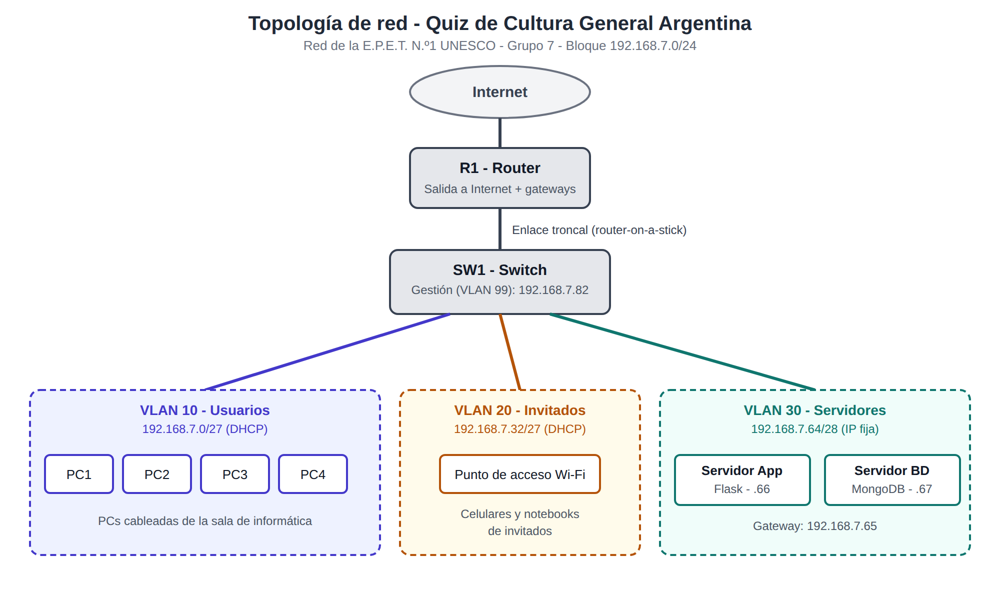

# REDES.md - Diseño de red del Quiz de Cultura General Argentina

E.P.E.T. N.º 1 UNESCO - Proyecto Integrador Final ExpoTécnica 2026
Materias: Programación II + Bases de Datos II + Seguridad Informática + Redes Informáticas

**Grupo 7**
Integrantes:
- Kannemann Dago
- Romero Matías

## 1. Organización y escenario

Imaginamos que nuestra aplicación, un quiz de preguntas de cultura general argentina, se usa dentro de la escuela (E.P.E.T. N.º 1), en la sala de informática. Los alumnos juegan desde las PCs de la sala y los visitantes (por ejemplo, en la ExpoTécnica) se conectan por Wi-Fi desde el celular.

La red tiene:
- 1 servidor de aplicación (donde corre Flask)
- 1 servidor de base de datos (donde corre MongoDB)
- PCs cableadas para los usuarios
- Wi-Fi para invitados, separado del resto
- 1 router con salida a Internet

## 2. Topología

Equipos del diagrama:
- 1 router (R1)
- 1 switch (SW1), conectado al router con un enlace troncal
- 1 punto de acceso Wi-Fi
- 1 servidor de aplicación
- 1 servidor de base de datos
- 4 PCs de usuarios

## 3. VLANs y direccionamiento

Nos asignaron el bloque **192.168.7.0/24** (grupo 7). Lo dividimos con VLSM según los equipos que necesita cada VLAN, empezando por la subred más grande.

| VLAN (ID y nombre) | Red / Prefijo | Máscara | Rango de hosts | Gateway | Hosts útiles |
|---|---|---|---|---|---|
| 10 - Usuarios | 192.168.7.0/27 | 255.255.255.224 | 192.168.7.1 - .30 | 192.168.7.1 | 30 |
| 20 - Invitados | 192.168.7.32/27 | 255.255.255.224 | 192.168.7.33 - .62 | 192.168.7.33 | 30 |
| 30 - Servidores | 192.168.7.64/28 | 255.255.255.240 | 192.168.7.65 - .78 | 192.168.7.65 | 14 |
| 99 - Gestión | 192.168.7.80/29 | 255.255.255.248 | 192.168.7.81 - .86 | 192.168.7.81 | 6 |

Como la tabla del TP, en "hosts útiles" contamos también la dirección del gateway, que es la primera de cada rango.

Quedan libres las direcciones desde 192.168.7.88 hasta 192.168.7.255 por si hay que agregar otra VLAN más adelante.

### Cómo hicimos el subnetting (VLSM)

| VLAN | Equipos que necesita (aprox.) | Prefijo elegido | Por qué |
|---|---|---|---|
| Usuarios | hasta 30 | /27 | Un /27 da 30 hosts útiles (32 direcciones - red - broadcast) |
| Invitados | hasta 30 | /27 | Misma cantidad, pensando en muchos celulares conectados |
| Servidores | 2 servidores + gateway | /28 | Un /28 da 14 hosts, sobra espacio para crecer |
| Gestión | switch + gateway | /29 | Un /29 da 6 hosts, es lo mínimo razonable |

Orden de asignación: primero las dos /27 (192.168.7.0 y 192.168.7.32), después la /28 (192.168.7.64) y al final la /29 (192.168.7.80). Así no se superponen y no se desperdician direcciones.

### Asignación de IPs

**Direcciones fijas:**

| Equipo | VLAN | IP |
|---|---|---|
| Router, subinterfaz VLAN 10 | 10 | 192.168.7.1 |
| Router, subinterfaz VLAN 20 | 20 | 192.168.7.33 |
| Router, subinterfaz VLAN 30 | 30 | 192.168.7.65 |
| Router, subinterfaz VLAN 99 | 99 | 192.168.7.81 |
| Servidor de aplicación (Flask) | 30 | 192.168.7.66 |
| Servidor de base de datos (MongoDB) | 30 | 192.168.7.67 |
| Switch SW1 (gestión) | 99 | 192.168.7.82 |

**DHCP:**
- Usuarios: de 192.168.7.2 a 192.168.7.30 (se excluye el .1 del gateway)
- Invitados: de 192.168.7.34 a 192.168.7.62 (se excluye el .33 del gateway)

## 4. Justificación de las decisiones

- **Separamos en VLANs** para que el tráfico de los invitados no se mezcle con el de los usuarios ni con el de los servidores. Más adelante, con las ACL, vamos a bloquear el acceso de invitados a los servidores.
- **Servidores en su propia VLAN** para poder controlar quién llega a la aplicación y a la base de datos.
- **IP fija para los servidores** porque el DNS y las reglas de acceso tienen que apuntar siempre al mismo lugar. Usuarios e invitados usan DHCP porque los equipos cambian seguido.
- **VLSM** para no desperdiciar direcciones: cada VLAN tiene el tamaño que necesita.
- **VLAN de gestión** para poder administrar el switch por SSH sin usar la red de los usuarios.
- **Router-on-a-stick:** un solo cable entre el router y el switch con subinterfaces, porque alcanza para esta red y usa pocos equipos.

## 5. Pendiente (se completa en las próximas partes)

- Parte 2: configuración en Packet Tracer (VLANs, DHCP, DNS, ACL, SSH) y capturas de las pruebas.
- Parte 3: fragmentos de configuración, registro de pruebas, bitácora de problemas y tabla de integración con Seguridad.
